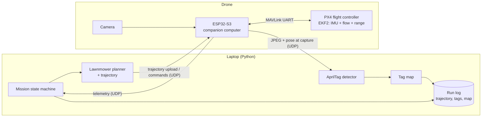
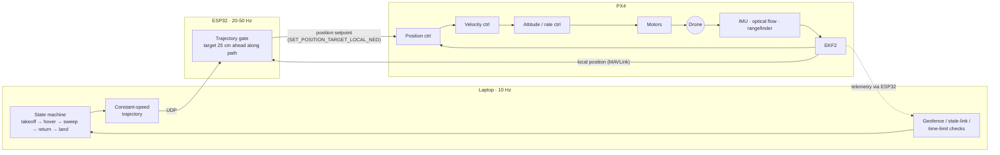

# CDE1302 Autonomous UAV: AprilTag search

CDE1302 *Introduction to UAVs* mini project, AY2026/27.

A small indoor quadcopter takes off, sweeps an allocated rectangle in a
lawnmower pattern, and records every AprilTag on the floor. It then returns to
its takeoff spot and lands. After the flight it reports each tag's position and
reconstructs the route it flew.

The drone is **pseudo-autonomous**. A laptop plans the sweep and runs the tag
detection over Wi-Fi, and the drone flies the uploaded path by itself. An
operator starts the mission and keeps the RC kill switch in hand.

> **[Image placeholder]** Drone photo / final run map (`map.png`)

## System overview



## Control architecture

Position control is cascaded across three devices. The laptop handles mission
logic and safety, the ESP32 runs the trajectory, and PX4 stabilises the drone.



The ESP32 moves the target along the path only as fast as the drone follows
it, so speed stays steady and Wi-Fi drops don't affect the flight path. The
laptop can command a hold or a landing at any time.

**Tag localisation:** the ESP32 pairs each camera frame with PX4's position at
capture time. The laptop detects tag16h5 tags in the frame and converts each
one camera → body → PX4 local NED. A tag is confirmed once enough sightings
cluster together (median-based, outliers rejected).

## Subsystems

| Subsystem | Contents |
|---|---|
| [Software](cde1302/) | ESP32 firmware (`main/`), course laptop tools (`laptop/`), the search mission (`mission/`). Start with [`cde1302/mission/README.md`](cde1302/mission/README.md) to fly the mission |
| [Mechanical](mechanical/) | Redesigned 3D-printed frame: stiffer arms, no print supports, faster assembly. CAD + STLs |
| [Electrical](electrical/) | Onboard hardware, wiring and network |

## Repository layout

```
├── cde1302/              Software
│   ├── main/             ESP32-S3 firmware (ESP-IDF, FreeRTOS)
│   ├── laptop/           Course-provided laptop tools (comms, camera viewer, detector)
│   ├── mission/          AprilTag search mission, simulator, tests, flight logs
│   ├── trajectory/       MATLAB trajectory generators (course labs)
│   └── waypoints/        Waypoint test files (course labs)
├── mechanical/           Frame redesign: STEP, STLs, design notes
├── electrical/           Hardware architecture and wiring
└── UWB_documentation/    LinkTrack UWB datasheets (evaluated, not used)
```
