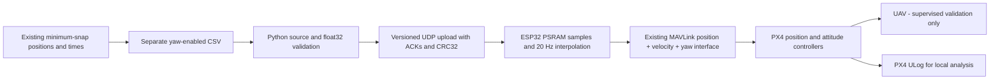

# Lab 5 strict tangent-yaw experiment - Drone 2

This is an **offline-tested implementation candidate**, not a flight-cleared mission.
The physical drone belongs on the teammate's connected laptop. The development
laptop only edits and tests software: no calibration, adapter changes, flashing,
arming, takeoff, or drone commands were performed on it.

## Current flight blocker

The unchanged minimum-snap CSV contains small low-speed direction reversals.
Strictly facing its actual direction of travel therefore needs much faster yaw
than a smooth ideal ellipse suggests:

| Reference | Interval since playback start | Required yaw rate |
|---|---|---:|
| Original 100 Hz CSV | 2.13 to 2.14 s | 54.377437 rad/s |
| Original 100 Hz CSV | 31.86 to 31.87 s | 54.377437 rad/s |
| Uploaded 20 Hz float32 samples | 2.10 to 2.15 s | 39.295540 rad/s |

The 100 Hz peak is approximately 31.16 degrees in 10 milliseconds. At the
31.86/31.87 s peak the horizontal speeds are only about 0.00199/0.00164 m/s.
These exceed the numerical direction threshold, so the strict policy follows
them. Other violations also occur near 1.94 s and 32.05 s.

The audited uploader limit was **1.0 rad/s**. The new firmware has a conservative
**1.0 rad/s hard ceiling**, which is an engineering guard, not TA approval.
The uploader's offline default is **0.6 rad/s**; live tangent mode requires an
explicit limit. Both reject this CSV. Downsampling cannot hide the original
violation because validation checks the source before resampling.

The user selected **keep strict tangent and document the blocker**. No low-speed
exception was generated. The original ellipse, 34 s duration, speed limit,
position samples, controller gains, and safety mechanisms were not changed.
Do not raise the limit or change `--stationary-speed` to make this mission pass.
Any future experiment change needs the user's approval and TA review.

## Repository and architecture

Team repository: <https://github.com/eggsacc/CDE1302-Autonomous-UAV>

Branch: `yaw_test_lab5`; starting team commit:
`222d9160c71642ae0f52e94fac27c971ca715b17`.
No lecturer repository was cloned inside this repository or pushed to.
The lecturer source is already vendored in `cde1302/`. Its original upstream
commit identity is not recorded in this team's import; do not substitute the
lecturer's current HEAD for that unknown historical identity.

Requested development checkout (the folder itself is the Git root):

```text
C:\Users\Manan Mishra\OneDrive\Manan\National University of SINGAPORE (NUS)\Electrical Engineering related+ ecs+ccas\YEAR 2\CDE1302_DRONES\Yaw_lab_5_test
```



The simulator is a separate offline branch of this workflow. It never sends
setpoints to PX4 or verifies physical flight performance.

## Coordinates, timing and heading policy

- CSV time: seconds. Positions: metres in local NED, `x=North`, `y=East`,
  `z=Down`. Uploader subtracts only the first XYZ point. ESP32 adds the hover
  position captured at playback start. Yaw is absolute NED heading, not an offset
  added to the initial heading and not a rotation of the position path.
- Yaw: radians, clockwise from North, `atan2(vEast,vNorth)`.
- Fixed yaw stays the default. Four-column CSVs use original `0x08/0x09` packets
  and hold the heading captured by ESP32 when playback starts.
- Tangent CSV: `t,x,y,z,yaw_rad`. The first four fields are copied verbatim from
  each original row. All 3,401 rows match; no position-generation solve is replaced.
- Finite-difference velocity uses the actual sampled CSV. Direction is undefined
  when horizontal speed is at most `0.0001 m/s`. There are six such samples in
  this reference. Interpolate unwrapped yaw between defined samples; hold the
  nearest defined heading at the stationary beginning/end. An entirely stationary
  path is rejected. Angles are wrapped only at the MAVLink output boundary.
- The original lab placement points the nose +North. The actual first defined
  CSV tangent is **80.041 degrees clockwise from North**, not exactly 90 degrees.
  Python refuses a misaligned start before arming; ESP32 checks again at playback
  with a 5-degree tolerance. Neither performs an alignment turn. Any different
  initial placement must be approved by the TA; it does not solve the rate blocker.
- Both modes use the same 681 samples at 50 ms for the default 34 s ellipse.
  Tangent mode refuses sample periods below the actual 20 Hz update rate, or
  periods that would shorten the duration. Both modes serialize XYZ as float32;
  the source CSV fields remain unchanged.

## Changed files

All changes are under `cde1302/`:

| Files | Purpose |
|---|---|
| `laptop/send_trajectory.py`, `trajectory_runner.py` | Select modes; validate before networking; upload/start; fresh telemetry; local records |
| `laptop/trajectory_reference.py`, `generate_tangent_yaw.py` | Strict parsing, tangent maths, wrap-safe resampling, verbatim position/time export |
| `laptop/protocol.py` | Separate yaw v1 requests/replies; optional PX4 telemetry trailer |
| `main/traj_yaw.c`, `traj_yaw.h` | Portable upload state machine, finite/bounds/rate/CRC/heading checks |
| `main/wifi_task.c`, `wifi_task.h` | Route yaw commands and ACKs; reject oversized datagrams; add status trailer |
| `main/nav_task.c`, `nav_task.h`, `main/CMakeLists.txt` | Allocate PSRAM; integrate yaw playback into existing navigation and MAVLink calls |
| `trajectory/ellipse_min_snap_demo.m` | Optional separate yaw export; original position solver unchanged |
| `trajectory/tangent_yaw_reference.m`, `write_tangent_yaw_csv.m`, `compare_yaw_simulation.m` | MATLAB generation and optional simulation comparison |
| `trajectory/ellipse_min_snap_traj_tangent_yaw.csv` | Strict reference, retained despite being infeasible at the configured rate limits |
| `laptop/analyze_yaw_experiments.py` | Local ULog tracking analysis and plot export |
| `tools/prepare_yaw_drone2.py` | Generate isolated Drone-2 config and verify generated build header |
| `laptop/tests/test_tangent_yaw.py`, `test_yaw_analysis.py`, `yaw_core_wrapper.c` | Offline acceptance, actual C core, fake transport and synthetic analysis tests |
| `laptop/tests/test_firmware_pipeline.py`, `firmware_host/` | Compile actual navigation and MAVLink code with hardware stubs; check emitted UART bytes and safety gates |
| `laptop/requirements-yaw.txt`, `.gitignore`, this README, `TANGENT_YAW_TECHNICAL_REPORT.md` | Reproduction, privacy of local logs, handoff and readiness |

Original `trajectory/ellipse_min_snap_traj.csv`, original `sdkconfig`, Simulink
model, controller parameters, MAVLink implementation, estimator/optical-flow
configuration and unrelated team folders remain unchanged.

## Teammate: obtain the exact code and run offline first

Use the final handoff's commit SHA, not a later moving branch HEAD. A GitHub ZIP
download is also possible by selecting that exact commit. Extract into a short
path such as `C:\uav\Yaw_lab_5_test`. Firmware builds inside OneDrive or long paths
with spaces can fail; keep the requested development checkout but build a
separate exact-commit copy in a short directory on the teammate's machine.

Windows PowerShell (substitute the actual handoff SHA):

```powershell
git -c core.longpaths=true clone --branch yaw_test_lab5 --single-branch https://github.com/eggsacc/CDE1302-Autonomous-UAV.git C:\uav\Yaw_lab_5_test
Set-Location C:\uav\Yaw_lab_5_test
git checkout --detach <HANDOFF_COMMIT_SHA>
git rev-parse HEAD
Set-Location .\cde1302
py -3 -m venv .venv
.\.venv\Scripts\python.exe -m pip install -r laptop\requirements-yaw.txt
.\.venv\Scripts\python.exe laptop\send_trajectory.py --drone-id 2 --yaw-mode fixed --trajectory trajectory\ellipse_min_snap_traj.csv --dry-run
.\.venv\Scripts\python.exe laptop\send_trajectory.py --drone-id 2 --yaw-mode tangent --trajectory trajectory\ellipse_min_snap_traj_tangent_yaw.csv --max-yaw-rate 1.0 --dry-run
```

The fixed command must pass. The tangent command must **exit with a yaw-rate
error** for this exact reference. That rejection is the correct acceptance
result, not a reason to bypass the check. `--dry-run` does not construct a socket,
contact a drone, arm, take off, or send even a capability query.

The following is an offline regeneration command, not a flight command:

```powershell
.\.venv\Scripts\python.exe laptop\generate_tangent_yaw.py --plot logs\reference_audit.png
.\.venv\Scripts\python.exe -m pytest laptop\tests\test_traj.py laptop\tests\test_tangent_yaw.py laptop\tests\test_firmware_pipeline.py laptop\tests\test_yaw_analysis.py -q
```

Native C tests need GCC/Clang or Zig. On Windows, optionally set `$env:ZIG` to a
Zig executable; tests invoke `zig cc`. With no supported C compiler those tests
are explicitly skipped. Install `laptop/requirements.txt` as well for the full
camera/AprilTag suite; those packages are not needed to upload trajectories.

The firmware pipeline test compiles the actual `nav_task.c`, `mavlink_task.c`
and `traj_yaw.c` using test-only ESP-IDF stubs. Simulated PX4 telemetry enters
the real parser; outgoing UART bytes are decoded independently and checked for
MAVLink CRC, target, NED frame, XYZ, velocity, yaw and field mask. It verifies
all 681 original fixed-yaw points, a separate feasible synthetic tangent arc,
wrap crossing, final hold, duplicate START, telemetry loss, mode takeover,
nonfinite start-position rejection and the existing 300 ms setpoint watchdog.
It also sends the strict original ellipse directly to the C code and confirms
that firmware rejects it at 1 rad/s even without Python validation. The synthetic
arc is a temporary test fixture and never replaces the Lab 5 trajectory.

These tests have no real serial/network access or flight dynamics. They do not
verify ESP-IDF linking, PSRAM, FreeRTOS scheduling, Wi-Fi transport or PX4's
physical response; those remain deployment checks on the teammate's setup.

Ubuntu Bash equivalent (development/build only; use the teammate's normal native
flight OS for networking rather than assuming WSL forwards UDP correctly):

```bash
git clone --branch yaw_test_lab5 --single-branch https://github.com/eggsacc/CDE1302-Autonomous-UAV.git Yaw_lab_5_test
cd Yaw_lab_5_test
git checkout --detach <HANDOFF_COMMIT_SHA>
cd cde1302
python3 -m venv .venv
. .venv/bin/activate
python -m pip install -r laptop/requirements-yaw.txt
python laptop/send_trajectory.py --drone-id 2 --trajectory trajectory/ellipse_min_snap_traj.csv --dry-run
python -m pytest laptop/tests/test_traj.py laptop/tests/test_tangent_yaw.py laptop/tests/test_firmware_pipeline.py laptop/tests/test_yaw_analysis.py -q
```

## Protocol, storage and compatibility

Python and ESP32 must both implement **yaw protocol v1** from this commit.
The MAVLink/PX4 interface remains the existing `SET_POSITION_TARGET_LOCAL_NED`
position + velocity feedforward + yaw interface. No PX4 firmware change is needed.

All yaw requests start with little-endian `<BBBBI>`: command packet type `0x02`,
operation, version `1`, target drone ID, nonzero random 32-bit transfer ID.

| Operation | Byte | Additional fields |
|---|---|---|
| Capability query | `0x0A` | none |
| Begin | `0x0B` | total u16, dt_ms u16, approved max yaw rate f32, complete payload CRC32 u32 |
| Data | `0x0C` | offset u16, count u8, count times XYZ + unwrapped yaw f32 |
| Start | `0x0D` | none |
| Status | `0x0E` | none |

Replies are exactly 28 bytes, `<BBBBIHHHHfff>`: reply type `0x05`, version,
drone ID, echoed operation/transfer ID, status, received count, capacity,
minimum dt, max rate, heading tolerance, measured heading. Requests and ACKs use
one connected UDP socket, with replies sent to its ephemeral source port.
The legacy telemetry port remains 5005 and command port 5006.

Tangent chunks carry at most 60 points: **971 bytes**, below the 1,024-byte
receive limit. Legacy chunks remain 80 XYZ points: **968 bytes**. Oversized and
incorrect-length yaw packets, wrong versions/IDs, missing chunks, inconsistent
duplicates, nonfinite values, incorrect CRC32, excessive speed/rate, initial
position jumps and misaligned starts cannot start a new trajectory. START is
idempotent while playing and cannot replay a consumed upload. There is no
automatic legacy fallback after a missing or incompatible capability ACK.

CRC32 is IEEE/zlib CRC32 of the complete little-endian float32 payload. It checks
accidental corruption, not sender authentication. Use the permitted lab network;
this is not an authenticated remote-control protocol.

Capacity: 2,400 points. Original XYZ storage is 28,800 PSRAM bytes; yaw storage
adds 38,400 PSRAM bytes and a 300-byte receive bitmap plus small state. Default
playback updates every 50 ms and uses the original linear position interpolation
and segment velocity feedforward. Final hold uses the last requested yaw.

The original Wi-Fi link-loss hold/disarm handling, 300 ms stale-setpoint watchdog,
RC/mode takeover and landing path remain. Tangent playback additionally cancels
on stale attitude/heartbeat, invalid position, disarm or leaving Offboard. This
does not constitute a safety audit of the original firmware: its collision
avoidance function already returns immediately and ToF checks may be disabled.
Those existing settings were not changed or bypassed by this experiment.

Status codes: 0 capable, 1 uploading, 2 ready, 3 playing, 4 done; 10 malformed,
11 wrong version, 12 wrong/consumed ID, 13 busy, 14 incomplete, 15 corrupt,
16 limit violation, 17 not flying/fresh/Offboard, 18 heading mismatch,
19 cancelled. A new transfer ID is required after a corrupt or cancelled upload.

## Drone-2 firmware build - teammate's machine only

No full ESP-IDF installation was available during implementation. **An ESP32
build has not been completed.** Native C tests are not an ESP-IDF build.

The committed baseline config targets drone 22. Do not flash it unchanged.
Generate the separate ignored file without editing the original:

```powershell
.\.venv\Scripts\python.exe tools\prepare_yaw_drone2.py
```

It changes only `CONFIG_DRONE_ID=2`, ESP IP `192.168.1.202`, and receiving host
IP `192.168.1.102`. The **teammate's** Wi-Fi adapter must use the receiving
address on the lab network; this does not calibrate the drone to a laptop.
The router/gateway mapping is inherited from the lab: `192.168.1.1/24`.
The actual adapter, SSID, hardware UART pins, board/flash/PSRAM variant and USB
port must be checked with the TA. A successful config-generation test verifies
the file contents, not those physical facts.

Use the exact ESP-IDF pin in `tools/idf-pin.env`:
`08e0d30a74ad0bfd5a34933142b80f45619ee410`
(`v6.1-dev-6940-g08e0d30a74a`). The sdkconfig's display version alone does not
establish toolchain compatibility. Install this checkout's tools, not a different
release merely labelled v6.x. If the pin cannot be obtained or installed, stop
and report the error rather than silently changing toolchains.

Example Windows ESP-IDF preparation (internet and disk space required):

```powershell
git -c core.longpaths=true clone https://github.com/espressif/esp-idf.git C:\uav\esp-idf
git -C C:\uav\esp-idf checkout 08e0d30a74ad0bfd5a34933142b80f45619ee410
git -C C:\uav\esp-idf submodule update --init --recursive
& C:\uav\esp-idf\install.bat esp32s3
. C:\uav\esp-idf\export.ps1
git -C $env:IDF_PATH rev-parse HEAD
Set-Location C:\uav\Yaw_lab_5_test\cde1302
idf.py -B build-yaw-drone2 -D SDKCONFIG=sdkconfig.yaw-drone2 build
python tools\prepare_yaw_drone2.py --verify-header build-yaw-drone2\config\sdkconfig.h
```

Ubuntu Bash, after obtaining the same exact IDF checkout:

```bash
cd /path/to/esp-idf
./install.sh esp32s3
. ./export.sh
git rev-parse HEAD
cd /path/to/Yaw_lab_5_test/cde1302
python tools/prepare_yaw_drone2.py
idf.py -B build-yaw-drone2 -D SDKCONFIG=sdkconfig.yaw-drone2 build
python tools/prepare_yaw_drone2.py --verify-header build-yaw-drone2/config/sdkconfig.h
```

Retain the build log, exact Git commit, IDF/compiler versions, generated config,
memory usage and binary checksum locally. The TA must review the specific build.

## Authorised teammate deployment and supervised validation

The user reports TA approval to modify and flash firmware, but the specific build
and flight experiment still require review. No commands in this section were run
against a drone. Have the TA retain the previous known-working firmware/config
and an approved recovery procedure before deploying anything.

After a successful reviewed build, verify the USB serial port with the TA.
The following are **deployment commands for the teammate**, with `COM7` only an
example to replace with the actual port. Do not run the Bash flashing helper
blindly in PowerShell.

```powershell
# Only after board/config/build review, on the teammate's USB-connected machine:
idf.py -B build-yaw-drone2 -D SDKCONFIG=sdkconfig.yaw-drone2 -p COM7 flash
idf.py -B build-yaw-drone2 -D SDKCONFIG=sdkconfig.yaw-drone2 -p COM7 monitor
```

Opening a serial monitor may reset ESP32; do so before arming. Flashing is a
separate action from building, and does not fly the vehicle.

Props-off gate, with the TA and the existing manual recovery procedure:

1. Confirm board, Drone 2 boot identity, network addresses and fresh PX4 link.
2. Run only the harmless capability check first:
   `.\.venv\Scripts\python.exe laptop\send_trajectory.py --drone-id 2 --check-firmware --esp-ip 192.168.1.202`.
   Require v1, drone 2, capacity 2400, minimum dt 50 ms and expected bounds.
3. Verify legacy telemetry still parses and the optional armed/mode/age trailer
   is sensible. It still does not include altitude.
4. Inspect upload/refusal handling and PX4 yaw setpoint reception in the TA's
   approved props-off or SITL setup. Capability queries alone do not test the
   entire setpoint path. Trajectory START deliberately requires armed Offboard;
   do not bypass that gate for a desk test. Any arming is a separate TA action.
5. Verify HOLD/LAND/RC takeover and existing failsafes using the approved lab
   procedure; a laptop Ctrl+C fallback depends on the link and process surviving.

Physical flight is **blocked for the supplied strict tangent ellipse**. Before
any later revised experiment: obtain user/TA approval of any mathematical policy
change, instructor-approved yaw rate and initial heading, review ULog settings,
confirm altitude/stable hover in QGC, verify the actual footprint plus clearance,
and have the RC pilot/emergency procedures ready. Do not treat a successful
upload, compilation, or simulated trace as flight clearance.

The original fixed-yaw fallback command, for the teammate's separately cleared
Lab 5 session, remains:

```powershell
.\.venv\Scripts\python.exe laptop\send_trajectory.py --drone-id 2 --yaw-mode fixed --takeoff --takeoff-wait 12 --confirm --trajectory trajectory\ellipse_min_snap_traj.csv
```

It is a real flight command and was not executed during development. There is
no flight command recipe that makes the current strict tangent CSV acceptable
at the configured limits.

## Local logging and comparison

Live runs create ignored `logs/tangent_yaw/<run>/` records: sent float32 reference
CSV, source hash/settings, host send/ACK events and supplementary telemetry.
Fixed yaw is captured on ESP32; its CSV yaw cells are left blank rather than
inventing that heading from an earlier laptop observation.

Telemetry supplies map-frame North/East, estimated heading, nav/link information
and optional armed/mode status. It does not supply Down position, complete
controller state or complete estimator warnings. Do not subtract these map
positions from odom-frame references without establishing their transform.

Retrieve each flight's `.ulg` from the PX4 SD card (`log/`) or QGC's onboard
log-download feature after disarming, following the lab's normal procedure.
Verify required topics were recorded: `trajectory_setpoint` (requested NED XYZ
and yaw), `vehicle_local_position` (estimated XYZ and validity/reset counters),
`vehicle_attitude` (quaternion), and where available `vehicle_status`,
`estimator_status`, `estimator_status_flags` and logged messages. If the reference
topic is absent, configure logging with the TA for a later test; the tool does
not substitute measured motion for requested motion.

Identify playback start in **PX4 seconds since boot** separately for each log,
using ULog setpoints and the host events as context. Host wall time is not PX4
boot time. Never infer a successful flight from a file name or from MATLAB data.
Record whether each log came from physical flight or SITL; the parser cannot
certify provenance.

```powershell
# Replace example start times with the inspected PX4 playback start times:
.\.venv\Scripts\python.exe laptop\analyze_yaw_experiments.py --fixed-ulog logs\fixed.ulg --tangent-ulog logs\tangent.ulg --fixed-start-s 120.0 --tangent-start-s 145.0 --duration 34 --output logs\comparison_01
```

The tool compares logged references and estimates in the same NED frame, uses
shortest-arc yaw error and excludes invalid/extrapolated intervals and gaps over
0.25 s. It exports position/yaw tracking plots, horizontal/yaw error plots,
metrics, per-sample CSVs and available mode/estimator diagnostic context. New
output folders are required so previous analysis is not overwritten. ULogs,
identifying metadata and synthetic test plots are never uploaded automatically.

## MATLAB - optional, no further licensing investigation required

From the `cde1302` MATLAB working directory:

```matlab
addpath('trajectory');
write_tangent_yaw_csv('trajectory/ellipse_min_snap_traj.csv', ...
    'trajectory/ellipse_min_snap_traj_tangent_yaw.csv',1e-4);
% Optional simulation only; requires the existing model/toolboxes:
results = compare_yaw_simulation(fullfile('logs','simulation_yaw'));
```

The original generator also exposes `export_tangent_yaw=false` as an optional
switch. Its minimum-snap position solve is unchanged. MATLAB yaw export was
executed and agreed with the Python audit. A complete Simulink comparison was
not established; optional runs were stopped at the user's request. No Simulink
tracking or physical-flight performance pass is claimed. The comparison helper
has a 120 s wall-clock timeout per run and marks incomplete output as incomplete;
the original model, controller gains and solver settings are not saved or changed.

## Rollback and readiness

Software fallback: select `--yaw-mode fixed` and the original four-column CSV.
The updated firmware still accepts legacy packets. Full firmware rollback:
restore the TA's previous reviewed Drone-2 binary/config using their deployment
procedure. For rebuilding baseline code, use a separate checkout of
`222d9160c71642ae0f52e94fac27c971ca715b17` and verify Drone-2 configuration manually;
its committed defaults are Drone 22. Do not reset or overwrite team work.

- **Implemented:** both modes, separate strict reference, all required software
  hops, local evidence collection, offline ULog analysis, deployment instructions.
- **Tested:** 120 passed, 47 skipped in the full laptop suite; actual protocol,
  navigation and MAVLink C code compiled and exercised. Tests include Python-to-C
  ACK flow and independently decoded MAVLink UART bytes over fake hardware;
  none is a real drone test. The 47 skipped tests are the existing
  AprilTag host compiler tests. Fixed dry-run passes; strict ellipse rejection is
  required and verified. Source position/time fields match verbatim.
- **Built:** protocol/navigation/MAVLink code for host tests only. Full ESP32 firmware not built:
  pinned ESP-IDF/toolchain unavailable. Hardware/network mapping not verified.
- **Flight-validated:** no. No drone was flashed, armed or flown. The strict
  tangent ellipse is mathematically incompatible with the configured yaw limits.

No extra user approval is needed to commit/push this offline implementation to
the authorised branch. Hardware deployment, initial orientation, actual approved
rate and any future experiment changes remain separate review decisions.
