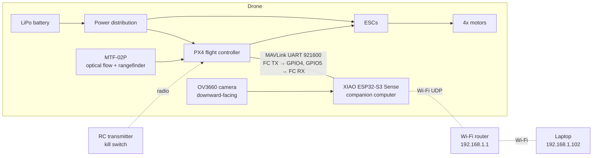

# Electrical

Onboard hardware and how it connects. Firmware and laptop software are in
[`../cde1302/`](../cde1302/).

## Architecture

> **[Image placeholder]** Wiring diagram / photo of the assembled electronics

## Components

| Component | Part | Role |
|---|---|---|
| Flight controller | PX4 *(TODO: board model)* | Attitude/position control. EKF2 fuses IMU + optical flow + rangefinder (no compass, no GPS) |
| Companion computer | Seeed XIAO ESP32-S3 Sense | MAVLink bridge to PX4, trajectory player, camera streaming over Wi-Fi |
| Camera | OV3660 on the XIAO Sense | Streams JPEG frames to the laptop for AprilTag detection |
| Flow / height sensor | MTF-02P | Optical flow for x/y velocity, ToF rangefinder for height (cover: `mechanical/STLs/mtf02p_cover.stl`) |
| Motors / ESCs | *(TODO)* | |
| Battery | *(TODO: cells, capacity)* | |
| Receiver | *(TODO)* | RC link with the kill switch, always kept in hand |

## Connections

| From | To | Notes |
|---|---|---|
| ESP32 GPIO5 (D4) TX | FC telemetry RX | MAVLink, 921600 baud (`CONFIG_PX4_TX_PIN`) |
| ESP32 GPIO4 (D3) RX | FC telemetry TX | (`CONFIG_PX4_RX_PIN`) |
| MTF-02P | FC *(TODO: port)* | PX4: `EKF2_OF_CTRL` = Enabled, `EKF2_HGT_REF` = Range sensor |

Pin settings live in `idf.py menuconfig` → *Drone Configuration*. The full PX4
parameter list is in [`cde1302/mission/README.md`](../cde1302/mission/README.md#3-px4-parameters-qgroundcontrol).

## Network

| Device | Address |
|---|---|
| Router | `TP-Link_E95A`, 192.168.1.1, no internet |
| Laptop | 192.168.1.102, static (= 100 + drone ID) |
| Drone 2 (ESP32) | 192.168.1.202 (= 200 + drone ID) |

If the ESP32 loses the router for more than about 3 s, the firmware cuts the
motors (Wi-Fi kill switch).

## Fitted or supported, but not used

- **LinkTrack UWB:** firmware and laptop support exist (`uwb_*` files), but our
  flight area is too small for UWB to improve on optical flow. Datasheets are
  in [`../UWB_documentation/`](../UWB_documentation/).
- **VL53L5CX ToF ring:** obstacle avoidance from the course template.
  It is compiled out (`TOF_ENABLED 0` in `main/tof_task.h`).

## Power budget

*(TODO: battery capacity, hover current, expected flight time.)*
