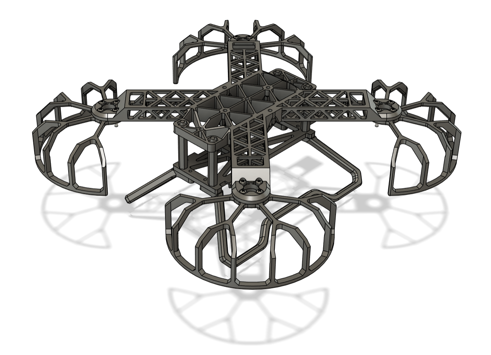
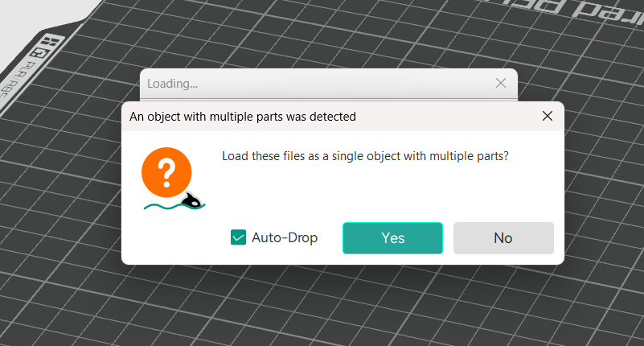

# Mechanical: drone frame redesign

The course frame was designed to be cut from carbon fibre, but we 3D print it in
PLA, which is roughly 20-30x less stiff. The printed frame flexed noticeably
under load, so we redesigned it for FDM printing: stiffer arms, faster assembly
and no print supports.

## Contents

| Path | What |
|---|---|
| [`STEP/drone.step`](STEP/drone.step) | Full assembly CAD (STEP) |
| [`STLs/`](STLs/) | Print-ready parts (see [Printing](#printing)) |
| [`assets/`](assets/) | Images used in this page |

## Design summary

| | Original (course) | Redesign |
|---|---|---|
| Max deflection, 30 N·m bending (PLA, simulated) | 14.4 mm | 5.31 mm (≈63% less) |
| Assembly time | ~1 hr | ~15 min |
| Print supports | Needed | None |
| Print time | ≈3.5 hr | ≈3.5 hr |
| Printed frame mass | ≈50 g | ≈50 g |
| All-up mass (with battery) | | ≈224 g |

### Arm stiffness

Bending stiffness scales with the second moment of area, `I = b·t³/12`, so it
grows fastest with the section depth `t`. The arms move material away from the
bending axis and hold it there with thin triangular trusses. The arms get much
deeper for about the same mass.

> **[Image placeholder]** Arm cross-section: original flat plate vs deeper truss section

> **[Image placeholder]** Bending simulation: original frame vs new frame (deflection colour map)

### Landing gear

Replaceable landing feet splay outwards to absorb landing impact. They replace
the nylon spacers of the original design, which often came loose on landing.

> **[Image placeholder]** Landing gear on the assembled frame

### Assembly features

- **Nut retainers:** nuts press into the frame, so the nylon stand-offs go in
  without tools.
- **Battery strap pass-through:** a recess with a slot under the flight
  controller for the battery velcro strap.
- **Wire channels:** modelled-in channels keep long leads away from the props.

> **[Image placeholder]** Nut retainers / velcro pass-through / wire channels

### Print-in-place design

FDM printers bridge gaps of about 20 mm and print overhangs below about 55° in
PLA without drooping. Every part stays within those limits:

- Prop guards: max bridge ≈16 mm, 45° chamfers in place of flat overhangs.
- Arms: staggered triangles support the top lattice bridges. Isogrid panels keep
  strength with less material.
- Circular overhangs can't be bridged, so small supports are modelled into the
  part. That is why the `import_together/` parts must be imported as one object.

> **[Image placeholder]** Prop guard in the slicer: new (no supports) vs old (supported)

All parts fit on one 256 × 256 mm bed.

## Printing

### Parts

| File | Qty | Notes |
|---|---|---|
| `STLs/import_together/main_frame.stl` + `s1`-`s4.stl` | 1 set | Import together as **one object with multiple parts**; `s1`-`s4` are the modelled-in supports |
| `STLs/bottom_panel.stl` | 1 | |
| `STLs/landing_leg(x2).stl` | 2 | |
| `STLs/prop_guard(x4).stl` | 4 | |
| `STLs/mtf02p_cover.stl` | 1 | Cover for the MTF-02P optical flow / range sensor |

<!-- TODO: `STLs/landing_leg(x2) - Copy.stl` is byte-identical to the original;
     `STLs/prop_guard(x4) - Copy.stl` differs from `prop_guard(x4).stl` and is the
     newer file. Decide which prop guard is current and delete the copies. -->

### Slicer import

1. Import every file in `STLs/import_together/` **first**, as a single object
   with multiple parts (answer *Yes* when the slicer asks).
2. Import the other parts as separate objects, duplicated to the quantity in
   the file name.

### Slicer settings

Defaults are fine:

| Parameter | Value |
|---|---|
| Layer height | 0.2 mm |
| Wall loops | 2 |
| Infill | 15% |
| Brim | None |
| Supports | **Off** |

> [!IMPORTANT]
> Turn supports off. The parts are designed to print without them, and the
> `import_together` parts already carry their own.
